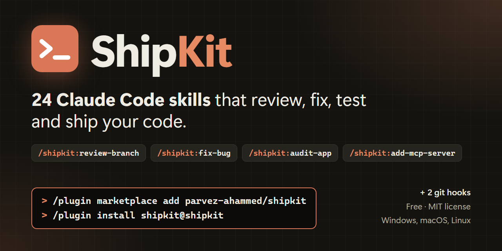

<div align="center">



# ShipKit: Claude Code skills that review, fix, test and ship your code

**24 production-ready [Claude Code](https://claude.com/claude-code) skills that work like a senior dev team in your terminal:
a multi-seat code reviewer, a root-cause bug fixer, a QA + UX auditor, a refactoring coach, a ticket groomer, a VPS deployer, an MCP server builder, a promo-video maker and more.**

[](LICENSE)
[](https://claude.com/claude-code)
[](#-the-skills)
[](https://github.com/parvez-ahammed/shipkit/actions/workflows/validate.yml)
[](#-requirements)
[](CONTRIBUTING.md)

[Install](#-install-in-30-seconds) · [Skills](#-the-skills) · [Examples](#-what-you-can-say) · [FAQ](#-faq) · [Website](https://parvez-ahammed.github.io/shipkit/)

</div>

---

## ⚡ Install in 30 seconds

In Claude Code:

```
/plugin marketplace add parvez-ahammed/shipkit
/plugin install shipkit@shipkit
```

That's it. Skills trigger on their own when your request matches, or you can run one
directly as `/shipkit:<skill>`, for example `/shipkit:review-branch`. Three skills run only
when you type their command, so they add nothing to your context until then:
`/shipkit:deliver-issue`, `/shipkit:show-usage` and `/shipkit:fill-timesheet`.
Update later with `/plugin marketplace update shipkit`.

## 💬 What you can say

You don't need to remember any command. Just ask:

| You type | ShipKit runs |
|----------|--------------|
| "review my PR before I open it" | `review-branch` - six reviewer seats, a refutation pass, one ranked punch list |
| "this endpoint returns 500 since yesterday, fix it" | `fix-bug` - reproduce, prove the root cause, regression test, verify |
| "implement this ticket" | `build-story` - analyze, break down, implement, test, pre-PR gate |
| "QA the app and tell me if it's ready to ship" | `audit-app` - QA release report + UX audit with screenshots |
| "find UX problems and file tickets" | `find-ux-gaps` - parallel auditors, evidence per issue, files only after you say yes |
| "is checkout really bulletproof?" | `grill-feature` - checks the real promise in code: BULLETPROOF / CRACKED / FAKE |
| "this class is a mess, refactor it" | `refactor` - smells with `file:line`, safe mechanics, patterns only when they score |
| "is ticket #42 ready to build?" | `groom-issue` - readiness score, gaps, blockers, a buildable plan |
| `/shipkit:deliver-issue #42` | `deliver-issue` - groom, build, review and test each issue; asks before pushing |
| "this service is over-engineered, simplify it" | `simplify-code` - behavior-preserving cuts, verified by your gates |
| "deploy my app to my VPS on every push" | `deploy-to-vps` - GitHub Actions, Caddy HTTPS, DNS, OAuth, server hardening |
| "make a 30-second promo video of this project" | `make-video` - MP4 with voice-over, music, captions and thumbnail, built from code |
| "let me ask Claude and ChatGPT about my app's data" | `add-mcp-server` - read-only MCP tools on your own report queries, API keys and OAuth 2.1, tested with the MCP Inspector |
| "why doesn't my site show up in ChatGPT answers?" | `boost-seo` - SEO + AEO audit, JSON-LD, llms.txt, proven with local tests |

## 🧰 The skills

### Review and fix

| Skill | What it does |
|-------|--------------|
| [`review-branch`](plugins/shipkit/skills/review-branch/SKILL.md) | Multi-seat code review of a branch or PR: backend, frontend, architecture, tests, QA and text seats, plus a licence seat for new dependencies. Every finding survives a refutation pass. Ranked punch list + HTML report. Optional comment mode posts re-verified findings to GitHub, GitLab or Azure DevOps. |
| [`fix-bug`](plugins/shipkit/skills/fix-bug/SKILL.md) | One bug end to end: reproduce, prove the root cause before any fix, write a regression test that fails without the fix, verify. |
| [`build-story`](plugins/shipkit/skills/build-story/SKILL.md) | One user story or ticket end to end: skeptical requirement analysis, task breakdown, implement, test, and a pre-PR gate (criteria trace, backward compatibility, every caller of a changed endpoint). |
| [`test-branch`](plugins/shipkit/skills/test-branch/SKILL.md) | Tests a branch against the real running app, not the diff: seeds data, drives the API and browser, and writes an HTML report with screenshots a product owner can read. |
| [`grill-feature`](plugins/shipkit/skills/grill-feature/SKILL.md) | Interrogates shipped features at the promise level ("can users really do X?") and answers from the code with `file:line` evidence. |

### Plan and deliver

| Skill | What it does |
|-------|--------------|
| [`groom-issue`](plugins/shipkit/skills/groom-issue/SKILL.md) | Scores a ticket's readiness against a rubric, finds gaps and undeclared blockers, and rewrites it into a buildable plan only after you confirm. Brief mode gives an executive brief of a milestone in build order, with risks and open questions. |
| [`deliver-issue`](plugins/shipkit/skills/deliver-issue/SKILL.md) | Delivers one issue or a whole milestone end to end: groom, plan, build, review, test, ship. Pushing, PRs and merges wait for your yes. |
| [`price-product`](plugins/shipkit/skills/price-product/SKILL.md) | Pricing tiers, margin-safety per tier, competitor prices with cited sources, value metric, and a check of every price surface for contradictions. |

### QA and UX

| Skill | What it does |
|-------|--------------|
| [`audit-app`](plugins/shipkit/skills/audit-app/SKILL.md) | Pressure-tests a running web app: a Staff-QA release report and a six-persona UX audit, two cross-linked HTML reports with screenshot evidence. Never invents data; anything unverified is UNKNOWN. |
| [`find-ux-gaps`](plugins/shipkit/skills/find-ux-gaps/SKILL.md) | Partitions the app, fans out parallel UX auditors, triages, and turns the survivors into tickets for GitHub, GitLab, Jira or Azure DevOps after you confirm. Works even when the app cannot be run. |

### Refactor and architecture

| Skill | What it does |
|-------|--------------|
| [`refactor`](plugins/shipkit/skills/refactor/SKILL.md) | Finds the 22 classic code smells, gives Martin Fowler's safe refactoring mechanics, and scores creational, structural and behavioral design patterns against your code: APPLY / CONSIDER / REJECT with `file:line` evidence. |
| [`enforce-clean-architecture`](plugins/shipkit/skills/enforce-clean-architecture/SKILL.md) | Clean / Hexagonal architecture rulebook, per-stack bootstrap (.NET, TypeScript, Java, Go, Python) and a layering guard you can run in CI. |
| [`find-shared-code`](plugins/shipkit/skills/find-shared-code/SKILL.md) | Finds what is worth sharing across a backlog with DRY / KISS / YAGNI judgment, and what to resist abstracting. |
| [`simplify-code`](plugins/shipkit/skills/simplify-code/SKILL.md) | Removes over-engineering in one behavior-preserving change set: dead code, needless layers, reinvented helpers. Verified by your own build and tests. |
| [`trim-comments`](plugins/shipkit/skills/trim-comments/SKILL.md) | Deletes comments that restate the code or narrate history and keeps the ones that explain a non-obvious why. Comment-only, gate-verified. |

### Ship and operate

| Skill | What it does |
|-------|--------------|
| [`deploy-to-vps`](plugins/shipkit/skills/deploy-to-vps/SKILL.md) | Push-to-deploy CI/CD for any containerized app to any VPS: GitHub Actions, Caddy auto-HTTPS, DNS, OAuth redirects and baseline hardening. Includes health endpoints that report real readiness, and the traps that make deploys go green while the app is down. |
| [`add-mcp-server`](plugins/shipkit/skills/add-mcp-server/SKILL.md) | Adds an MCP server to an existing app so its owner can connect Claude (Code, claude.ai, Desktop) or ChatGPT and ask about their own data: read-only tools on the app's own report queries, tenant and scope limits, scoped API keys and OAuth 2.1, tested with the MCP Inspector. Any stack. |
| [`boost-seo`](plugins/shipkit/skills/boost-seo/SKILL.md) | SEO and AEO (AI answer engines) audit and fixes: meta tags, JSON-LD, robots, sitemap, llms.txt, SPA prerendering, proven with local test scripts. |

### Create and document

| Skill | What it does |
|-------|--------------|
| [`make-video`](plugins/shipkit/skills/make-video/SKILL.md) | Promo, explainer and social videos built entirely from code: HTML scenes, local text-to-speech, generated music, captions and thumbnail, rendered to MP4. Every on-screen claim is checked. |
| [`make-demo`](plugins/shipkit/skills/make-demo/SKILL.md) | Pixel-exact clickable HTML demo of a planned workflow, captured from your real running app. |
| [`write-user-guide`](plugins/shipkit/skills/write-user-guide/SKILL.md) | End-user feature guide for a ticket or PR as HTML + PDF; a fresh agent checks every claim against the code. |
| [`write-plainly`](plugins/shipkit/skills/write-plainly/SKILL.md) | A plain-English house style for commits, PR descriptions, code comments and docs, with a PR-description writer that fills any repo's template. |

### Insight

| Skill | What it does |
|-------|--------------|
| [`show-usage`](plugins/shipkit/skills/show-usage/SKILL.md) | WakaTime-style active time, tokens and cost per project from your local Claude Code transcripts. Read-only, zero dependencies. |
| [`fill-timesheet`](plugins/shipkit/skills/fill-timesheet/SKILL.md) | Reconstructs what you worked on for past dates, as paste-ready timesheet rows. |

### Git hooks (bonus)

| Hook | What it does |
|------|--------------|
| [`secret-hygiene`](hooks/secret-hygiene/README.md) | Blocks a commit that adds a secret (gitleaks when installed, regex fallback). Works as a git hook or a Claude Code `PreToolUse` hook. |
| [`safe-commit`](hooks/safe-commit/README.md) | Commit-message validator: conventional subject, length, stray `@` lines; optional em-dash and AI co-author checks. |

Install a hook with `bash hooks/<hook>/install.sh /path/to/repo` or
`pwsh -File hooks/<hook>/install.ps1 -Repo C:\path\to\repo`.

## 🎯 Why ShipKit

- **Evidence over vibes.** Reviews, audits and refactoring advice cite `file:line`. Findings
  that can't be proven are dropped or marked UNKNOWN, not padded in.
- **Root cause before fix.** `fix-bug` won't write a fix until it can explain the bug, and
  ships a regression test that fails without the fix.
- **Asks before acting outside your machine.** Posting PR comments, filing tickets or
  attaching files always shows you what will be sent and waits for a yes.
- **Any stack, any OS.** No framework lock-in. Windows, macOS and Linux; where a helper
  script depends on the shell, there is a bash and a PowerShell version.
- **Built to the current skill spec.** Each skill is a self-contained folder (`SKILL.md` +
  references + scripts) that follows the [Agent Skills](https://agentskills.io) format, so it also works
  when copied on its own.

## 📋 Requirements

Most skills need nothing but Claude Code. Skills that run bundled tools say so in their
`compatibility` field:

| Skill | Needs |
|-------|-------|
| make-video | Node 22+, `npm ci` in `engine/` (bundles Playwright Chromium and ffmpeg) |
| make-demo | Python 3.11+, a browser tool (e.g. Playwright MCP); optional .NET 10 for the Windows desktop adapter |
| write-user-guide | Python 3.11+ with PyMuPDF, Chrome / Chromium / Edge; tracker CLI only if attaching |
| audit-app, test-branch | the app running locally, a browser tool (e.g. Playwright MCP) |
| boost-seo, show-usage | Node 22+ |
| enforce-clean-architecture | PowerShell 7 (`pwsh`, cross-platform) or Windows PowerShell 5.1 for the layering guard |
| add-mcp-server | the app's toolchain and the official MCP SDK; Node 22+ for the MCP Inspector; public HTTPS for claude.ai and ChatGPT |
| deploy-to-vps | GitHub Actions, an Ubuntu VPS with Docker, `gh`; `pwsh` or `bash` for secret migration |
| review-branch | git; `gh` / `glab` / `az` only for comment mode |

## ❓ FAQ

**What is a Claude Code skill?**
A folder with a `SKILL.md` that teaches Claude Code how to do one job well. Claude reads the
skill's description and loads it automatically when your request matches. You can also run
it yourself as a slash command.

**Can I install just one skill?**
Yes. Copy its folder from `plugins/shipkit/skills/` into `~/.claude/skills/` (for you) or
`.claude/skills/` in a project (for your team). Each skill folder is self-contained.

**Does it work on Windows?**
Yes. Every skill runs on Windows, macOS and Linux; where a shell matters there is a bash
and a PowerShell version. The only Windows-only piece is `make-demo`'s optional adapter for
WinForms desktop apps.

**Is it free?**
Yes, MIT licensed. Skills run inside your own Claude Code session.

## 🛠 Develop locally

```bash
git clone https://github.com/parvez-ahammed/shipkit
cd shipkit
bash sync-skills.sh            # or: pwsh -File sync-skills.ps1   (copies skills into ~/.claude/skills)
claude plugin validate . && claude plugin validate plugins/shipkit
```

Or point Claude Code at your clone with `/plugin marketplace add .`.

```
shipkit/
  .claude-plugin/marketplace.json   marketplace manifest (name: shipkit)
  plugins/shipkit/                  the plugin
    .claude-plugin/plugin.json
    skills/<skill>/SKILL.md         one folder per skill
  hooks/                            git hooks (bash + PowerShell installers)
  _template/SKILL.md                starting point for a new skill
  docs/                             project website (GitHub Pages)
```

## 🤝 Contributing

New skills, fixes and ideas are welcome. Read [CONTRIBUTING.md](CONTRIBUTING.md), start from
[`_template/SKILL.md`](_template/SKILL.md), and open a PR. Got an idea but no time?
[Open a skill request](https://github.com/parvez-ahammed/shipkit/issues/new/choose).

If ShipKit saves you time, **a ⭐ helps other developers find it.**

## 🙏 Credits

- `refactor` follows the code-smell and refactoring catalogue of
  [refactoring.guru](https://refactoring.guru) and Martin Fowler's *Refactoring*, and the
  Gang of Four design patterns. The text is written from scratch.
- The ideas behind `fix-bug` and `grill-feature` started from
  [obra/superpowers](https://github.com/obra/superpowers) and
  [mattpocock/skills](https://github.com/mattpocock/skills) (both MIT).

## 📄 License

MIT © 2026 ShipKit contributors. See [LICENSE](LICENSE).
